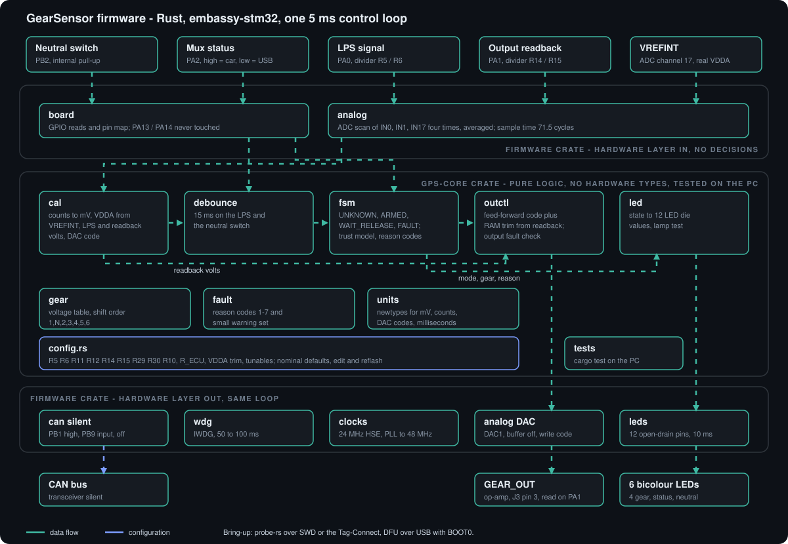

# GearSensor firmware plan

Plan for the firmware of the STM32F072CB gear position sensor board. It replaces the Arduino UNO R4 WiFi firmware described on the [project page](https://chithigunatilake.com/GearSensor/) and covers only what this board has: no WiFi, Bluetooth or phone display.



## Decisions

- **Language: Rust** (decided). `embassy-stm32` for the HAL, `probe-rs` and `defmt` for flashing and logging, target `thumbv6m-none-eabi`.
- **Closed loop:** the gear output is set from a feed-forward calculation and trimmed from the ADC readback on `PA1`.
- **Measured resistor values:** one `config.rs` constants block holds the real resistor values and a VDDA trim. Edit it and reflash.
- **Scope kept small:** no flash-stored calibration, no USB logging, no CAN receive stack. See "Left out" at the end.

## Hardware this plan is written against

Netlist of 2026-11-11 with `R10` = 1 M and `MUX_STAT` on `PA2`.

| Function | Pin | Notes |
|---|---|---|
| LPS signal | `PA0` (ADC_IN0) | divider `R5` 10 k / `R6` 15 k, ratio 0.6 |
| Gear output readback | `PA1` (ADC_IN1) | divider `R14` 10 k / `R15` 15 k, ratio 0.6, taken after `R29`/`R30` |
| DAC | `PA4` (DAC_OUT1) | buffer **off**; into op-amp `U4A`, gain `1 + R11/R12` = 1.499; `R10` 1 M to GND |
| Neutral switch | `PB2` | closed to GND = neutral, `R28` 1 k series |
| Mux status | `PA2` | `TPS2116` ST, open-drain: high = car, low = USB |
| LEDs (open-drain, low = on) | `PB10`-`PB15`, `PA8`, `PA15`, `PB3`-`PB6` | 12 dies, 390 ohm red, 680 ohm green |
| CAN | `PB9` TXD, `PB8` RXD, `PB0` FLT, `PB1` SIL | silent only |
| Debug | `PA13`/`PA14`, NRST, BOOT0 | SWD on `J2` or the Tag-Connect `J4` |

## Architecture

Cargo workspace with two crates.

**`gps-core`** - `no_std`, `#![forbid(unsafe_code)]`, no hardware types, tested on the PC with `cargo test`.

| Module | Responsibility |
|---|---|
| `config` | Resistor values, VDDA trim, tunables. Constants with nominal defaults. |
| `units` | Newtypes for millivolts, ADC counts, DAC codes, milliseconds. |
| `cal` | Counts to volts, VDDA from VREFINT, voltage to DAC code (formulas below). |
| `gear` | Gear enum, voltage table, shift order 1, N, 2, 3, 4, 5, 6. |
| `debounce` | Sample-count debouncer used for the LPS and the neutral switch. |
| `fsm` | UNKNOWN, ARMED, WAIT_RELEASE, FAULT, and the trust model. |
| `fault` | Reason codes and the small warning set. |
| `outctl` | Feed-forward, RAM trim, readback fault detection. |
| `led` | State to 12 LED die on/off values, lamp test. |

**`firmware`** - thin hardware layer, no decisions: `board` (pins), `clocks` (24 MHz HSE, PLL to 48 MHz), `analog` (ADC scan, DAC with the buffer off), `leds`, `wdg` (IWDG), and the CAN-silent setup. Use `stm32-metapac` register access wherever `embassy-stm32` lacks a feature (DAC buffer-off bit, ADC sample time, VREFEN). Verify `embassy-stm32`'s STM32F072CB support first, and fall back to `stm32f0xx-hal` if it falls short.

## Timing: one 5 ms loop

A single `embassy` task on a 5 ms ticker does everything, since nothing else in the firmware can block it.

1. Scan ADC channels IN0, IN1 and IN17 four times and average. Sample time 71.5 cycles at a 12 MHz ADC clock (PCLK/4): about 7 us per conversion, 84 us for all 12. VREFINT needs at least 4 us, and the 6 kohm dividers are fine at this setting.
2. Read `PB2` and `PA2`.
3. Run the pure logic: `cal`, `debounce`, `fsm`, `outctl`.
4. Write the DAC.
5. Update the LED pattern every second tick (10 ms).
6. Feed the IWDG.

**Latency.** LPS crossing to first sample that sees it: 0 to 5 ms. Debounce: 15 ms. Compute and DAC: under 0.5 ms, plus 4 us DAC settling. Total: about 10 to 15.5 ms, well inside the M150's roughly 150 ms shift time. The debounce is 3 consecutive samples, matching the project page ("3 samples (15 ms)").

**Watchdog.** The LSI clock runs 30 to 60 kHz (datasheet), so use a nominal reload of about 75 ms, which gives a 50 to 100 ms real timeout. A reset leaves the output at 0 V through `R10` and starts in UNKNOWN. Read the reset-cause flags at boot (IWDGRSTF) and show a warning.

## State machine and faults

Carried over from the old firmware: modes, tunables, shift order, clamps at gear 1 and 6, and `ASSUME_FIRST_WHEN_LEAVING_NEUTRAL`. The neutral switch forces N in every running mode. The output is the gear voltage in ARMED and WAIT_RELEASE, and 0.0 V in UNKNOWN and FAULT.

| From to | Condition |
|---|---|
| power on to UNKNOWN | reason 1, output 0 V |
| UNKNOWN to ARMED (N) | neutral closed 15 ms **and the LPS inside the rest band 15 ms** (new) |
| ARMED to WAIT_RELEASE | LPS at or above 3.0 V or at or below 1.5 V for 15 ms; step the gear and update the output in the same tick |
| WAIT_RELEASE to ARMED | LPS back in 1.5 to 3.0 V for 15 ms **and** 100 ms since the shift; then check the neutral switch |
| neutral check: gear N but switch open | reason 2 to UNKNOWN (proposed destination) |
| neutral check: gear not N but switch closed | force N (the switch is trusted) |
| WAIT_RELEASE to FAULT | no return to rest within 2 s: reason 5 |
| any to FAULT | LPS outside 0.2 to 4.8 V for 15 ms: reason 4. VDDA implausible: reason 7 |
| FAULT or UNKNOWN to ARMED (N) | LPS valid and at rest 15 ms, neutral closed 15 ms |

| Code | Reason | Effect |
|---|---|---|
| 1 | not known at start-up | UNKNOWN |
| 2 | LPS count and switch disagree | UNKNOWN |
| 3 | neutral switch opened with no shift | UNKNOWN |
| 4 | LPS out of range | FAULT |
| 5 | LPS did not return to rest | FAULT |
| 6 (new) | output readback mismatch (stuck, shorted or pulled up) | output to 0 V, latched until the neutral switch is seen |
| 7 (new) | VDDA or VREFINT implausible (outside 3.0 to 3.6 V for 50 ms) | FAULT, since no ADC value can be trusted |

**Half and full shifts.** The tracked order is 1, N, 2, 3, 4, 5, 6. Between 1 and 2 there are half shifts (1 to N and N to 2) and one full shift (1 to 2, which passes through N). When a completed shift starts on gear 1 or 2 and crosses the N position, the neutral switch decides the destination at the post-shift check (LPS back at rest and 100 ms passed): switch closed means N, switch open means the full-shift destination (2 going up from 1, 1 going down from 2). The switch is ignored while the actuator is moving, so a full shift that passes through N does not stop in N. All other shifts (2 to 3 up to 5 to 6, and back) step one gear. The old page says the M150 does not command half shifts and that N to 1 is done by the driver with the clutch. Bring-up must record the LPS excursion and the neutral switch timing for half and full shifts to confirm that the switch at rest separates them.

**Reason 2, in plain terms.** Reason 2 means the firmware's gear count and the neutral switch disagree. For example it believes N but the switch is open. The board then cannot know whether it is in 1, 2 or something else, so the proposal is to output 0 V (UNKNOWN) until it sees neutral at rest again, which tells the M150 "I do not know" instead of sending a gear that may be wrong. The alternative is to keep sending the last gear and only raise a warning, which risks a wrong gear. Default in this plan: 0 V.

Warnings only, with no change to the output: DAC code clamped or trim at its limit, watchdog reset, running on USB power. An unplugged LPS reads 0 V through `R6`, so it trips reason 4.

**On USB power the LPS is unpowered,** so the board sits in FAULT reason 4. Bench tests need `SEN_5V` supplied on J3 pin 1.

## Calibration math and the resistor variables

`config.rs` holds these constants. Defaults are the nominal values, so measure the real resistors with a multimeter and edit the file.

| Constant | Default | Used for |
|---|---|---|
| `R5`, `R6` | 10 k, 15 k | LPS divider |
| `R14`, `R15` | 10 k, 15 k | readback divider |
| `R11`, `R12` | 4.99 k, 10 k | op-amp gain |
| `R29`, `R30` | 390, 390 | output series resistance |
| `R10` | 1 M | DAC loading |
| `R_ECU` | 1 M (ask MoTeC) | load on `GEAR_OUT` |
| `VDDA_TRIM` | 1.0 | VDDA measured with a meter divided by the VDDA the firmware computes |

```
VDDA_mV  = 3300 * VREFINT_CAL / avg(VREFINT_raw) * VDDA_TRIM      (VREFINT_CAL at 0x1FFFF7BA)
V_pin    = raw * VDDA_mV / 4095
V_lps    = V_pin * (R5 + R6) / R6                  sensor-side volts
V_rb     = V_pin(PA1) * (R14 + R15) / R15           what the ECU sees
G        = 1 + R11 / R12
Rs       = R29 * R30 / (R29 + R30);   R_load = (R14 + R15) || R_ECU
code_ff  = round( 4095 / VDDA_mV * V_target * (1 + Rs / R_load) / G )
code     = clamp(code_ff + trim[gear], 0, 4095);   V_target = 0 gives code 0 exactly
```

Do the per-tick math in integer millivolts with coefficients computed once at boot. One DAC step is about 1.2 mV at the connector and one readback step about 1.34 mV.

The DAC buffer-off output impedance varies with code, so it is not modelled. With `R10` at 1 M the loss is at most about 1.5%, and the trim absorbs it. Enable `ADC_CCR.VREFEN` and wait the 10 us startup before the first VDDA read.

## Closed-loop output control

- **Feed-forward:** when the command changes, write `code_ff + trim[gear]` in the same tick, so the shift path never waits on the loop.
- **Trim:** per-gear, kept in RAM only. Active once the command has been steady for 20 ms and VDDA is valid. Average the readback over 8 ticks. If the error `V_cmd - V_rb` exceeds a 6 mV deadband, nudge the trim by a bounded step toward zero. Limit it to about plus or minus 250 mV. Never move it while the command changes or at 0 V.
- **Readback fault (reason 6):** blank for 10 ms after each change. An error above 150 mV for 50 ms, or a readback above 200 mV when 0 V is commanded, trips reason 6. Output goes to 0 V and latches until the neutral switch is seen.
- **Start-up:** write DAC code 0 before enabling the DAC. With the DAC off, a readback above 200 mV means a pulled-up output (reason 6). Average VREFINT 64 times before any decision.
- **Error budget.** The DAC and ADC both scale with VDDA, so the loop settles to `V_target * VDDA_true / VDDA_estimate`. VREFINT_CAL is taken at 3.3 V plus or minus 10 mV, and its tempco is up to 100 ppm/degC (about 0.5% over 50 degC, or about 20 mV at 4.1 V). Add resistor tolerance and meter error. Realistic accuracy is plus or minus 30 to 50 mV, which is well inside the 300 mV half-step between gears. Set `VDDA_TRIM` from a meter reading of 3.3 V.
- **Brown-out.** The F0 has no programmable brown-out reset, so between about 2.0 and 3.0 V the output sags with VDDA until reason 7 trips after 50 ms. That is acceptable but worth knowing.
- **USB headroom.** Gear 6 needs about 4.13 V at the op-amp output. On a 4.45 V USB rail that is about 0.3 V of margin. A clamped code is a warning only.

## LEDs

On-board LEDs are for bench and pit diagnosis. Switch `SW3` cuts every LED in hardware. All 12 pins are 5 V tolerant and stay high-Z (LEDs dark) through reset.

| State | LED1 to LED3 | LED4 |
|---|---|---|
| ARMED, gear 1 to 6 | gear number in binary, green (1 = 001 to 6 = 110) | green |
| ARMED, N | 111, green | green |
| WAIT_RELEASE | new gear, green | amber (both dies) |
| UNKNOWN | reason code 1 to 3 in binary, red | red, blinking 2 Hz |
| FAULT | reason code 4 to 7 in binary, red | red, solid |

- **Status LED:** a 1 Hz heartbeat from the main loop, so it stops if the loop stalls. Green on car power, amber on USB power (mux status low), red when a fault is active.
- **Neutral LED:** green when the debounced switch is closed, red while reason 2 is active.
- **Lamp test:** at boot, one LED (both dies) at a time, 700 ms total, without blocking.
- **Current:** the real limit is 80 mA total sink on the MCU. All 12 dies at about 7 mA red and 3 mA green is about 60 mA. Avoid lighting both dies of an LED except for the amber states above. The bigger concern is the M150 sensor supply current, which is unverified.
- A thermometer-style gear display is a one-table change in `led.rs`.

## CAN

Not used. Keep the transceiver silent from the first instruction: drive `PB1` high (silent mode, `R13` pulls it low during reset), leave `PB9` as an input (`R7` keeps the bus recessive), and keep the bxCAN peripheral clock off. CAN never affects the gear output. A listen-only estimate stays a future option.

## Neutral input and mux status

- **`PB2`:** enable the internal pull-up in firmware. The neutral wire may also feed a neutral light. **Before connecting the board, measure the wire against ground with the switch open and the ignition on.** The old Arduino input used a plain pull-up, so it is probably floating, but if it sits at 12 V through the lamp, `PB2` (through `R28` and the TVS `D2`) would be damaged. If the wire is pulled above 3.6 V, turn the internal pull-up off (datasheet: it must be disabled above VDDIO + 0.3 V), which is why the pull-up is a config flag.
- **`PA2`:** enable the internal pull-up (the `TPS2116` ST pin is open-drain). High means car, low means USB.

## Requirements

1. Output 0.5, 1.1, 1.7, 2.3, 2.9, 3.5, 4.1 V for N and gears 1 to 6, and 0.0 V (code 0) in UNKNOWN, FAULT and output fault.
2. Upshift threshold 3.0 V and downshift 1.5 V on the sensor side, rest band 1.5 to 3.0 V, valid range 0.2 to 4.8 V, all tunable.
3. Sample period 5 ms, debounce 15 ms, settle 100 ms, release timeout 2 s.
4. Shift order 1, N, 2, 3, 4, 5, 6, clamped at 1 and 6, with the half/full shift rule above between 1 and 2. The neutral switch overrides the tracked gear in every running mode.
5. LPS crossing to new connector voltage: at most 21 ms in every bench trial (upper bound only).
6. After the output settles, error at the connector within plus or minus 50 mV (stated error budget above).
7. Readback fault (reason 6) detected within 60 ms after the blanking window; output goes to 0 V and latches until neutral.
8. VDDA measured through VREFINT; outside 3.0 to 3.6 V for 50 ms gives reason 7.
9. All resistor values and `VDDA_TRIM` live in one `config.rs`, with nominal defaults.
10. IWDG timeout 50 to 100 ms; output 0 V after any reset.
11. LED behaviour follows the table above; the heartbeat stops if the loop stalls.
12. CAN is silent at the transceiver and the controller, and never affects the output.
13. `gps-core` builds and tests on the PC and uses no hardware types.

## Tests

**On the PC** (`cargo test`): port the old test groups (state machine, fault reasons, LED patterns); calibration math against hand-calculated codes at nominal and altered resistor values and VDDA from 3.0 to 3.6 V; `outctl` against a simulated plant (gain, offset, noise): convergence, deadband, clamps, fault timing; latency with a random crossing phase; check the output is always a table value or 0 V.

**Bring-up on hardware:**
1. Flash and debug with `probe-rs` over SWD, or the Tag-Connect. DFU over USB with BOOT0 is the fallback.
2. Check the 48 MHz clock, then the lamp test.
3. VDDA from VREFINT against a meter, within 1%.
4. Sweep the LPS from 0 to 5 V on a bench supply and check thresholds.
5. Short the neutral input to ground.
6. Output per gear with feed-forward only, then with trim, with and without a load.
7. Fault injection: `GEAR_OUT` to ground, pulled to 5 V through 1 k, LPS disconnected, LPS held at 3.2 V for 2 s.
8. Scope the latency from a step on `SPS`, 100 trials.
9. Force a stall and confirm the watchdog resets.
10. In the car: set the M150 so 0 V is a fault, learn the gear voltages, measure the delay against the shift time.

## Hardware notes from this plan

- `R10` is 1 M (done).
- **Filter capacitors:** add 10 to 100 nF footprints on `SPS_DIV` and `GEAR_OUT_DIV`. The 6 kohm source has none today. 100 nF gives a 0.6 ms time constant, harmless next to the 15 ms debounce, and it stops EMI aliasing.
- **0.1% resistors** for `R14`/`R15` (and `R5`/`R6`, `R11`/`R12`) set the accuracy. Tolerance is not shown in the netlist.
- **Check the `R29`/`R30` power rating.** If `GEAR_OUT` is shorted to 5 V while the output is at 0 V, each 390 ohm resistor dissipates about 64 mW, and an 0402 is often rated 62.5 mW (unverified).

## Questions: settled and open

Settled:
1. **Shift order** 1, N, 2, 3, 4, 5, 6 with half shifts 1 to N and N to 2, and a full shift 1 to 2 (see the half and full shift rule).
2. **Arming rule:** UNKNOWN to ARMED also requires the LPS at rest.
3. **Debounce:** 3 samples.

Still open, none of them blocks starting the firmware:
1. **Reason 2:** 0 V until neutral is seen again (default), or keep sending the last gear with a warning.
2. **Neutral wire:** measure its voltage with the switch open before connecting (see above).
3. **`R_ECU`** (M150 gear input impedance): unknown, so the default is 1 M. The readback sits after the series resistors, so the loop corrects the output regardless. It only affects the feed-forward starting point.
4. **Readback fault threshold:** 150 mV is a tunable default that assumes the M150 windows each gear at plus or minus 0.3 V. Check it when the M150 learns the gear voltages in the car.

## Left out on purpose

Flash-stored calibration with CRC and A/B pages, a calibration tool, learned trims that persist across power cycles, USB CDC logging, the CAN receive stack and gear estimate, a bench characterisation command, TIM-triggered ADC with DMA, a second executor with dual watchdog checkpoints, and the extra neutral-stuck warnings. Each can be added later without changing the structure above.
