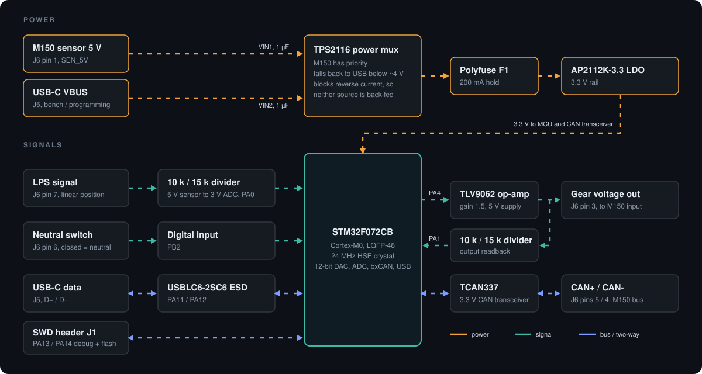

# GearSensor STM32

Gear position sensor board for a MoTeC M150 paddle-shift system: an `STM32F072` reads a linear position sensor and the neutral switch, works out the current gear, and reports it to the ECU as an analog voltage, with a CAN transceiver on the ECU bus and status LEDs on the board. Powered from the M150 sensor 5 V or USB-C, and replaces the Arduino UNO R4 WiFi and shield build described on the [GearSensor project page](https://chithigunatilake.com/GearSensor/).

## Architecture

- **Power** - 5 V in from the M150 sensor supply (`SEN_5V`, J3) or from USB-C VBUS (`J1`). A `TPS2116` power mux (`U2`) gives the car priority and falls back to USB when the car rail drops below about 4 V (set by `R3`/`R4`, 300 k / 100 k). It blocks reverse current, so the ECU supply is never back-fed from a laptop and the laptop is never back-fed from the car. The mux status pin goes to `PA2` (`MUX_STAT`: high = car, low = USB). 1 uF on each mux input, a 300 mA polyfuse (`F1`) on the mux output and an `AP2112K-3.3` LDO (`U1`) after it. There is no reverse-polarity stage because a sensor supply cannot be reversed by the battery.
- **Compute** - `STM32F072CB` (`U6`, LQFP-48) with a 24 MHz `ABM8AIG` crystal on HSE, which CAN needs for accurate bit timing. Ferrite-filtered VDDA, NRST and BOOT0 buttons.
- **Position and neutral sensing** - linear position sensor on J3 pin 7, scaled by `R5`/`R6` (10 k / 15 k) so a 5 V sensor swing lands inside the 3.3 V ADC range on `PA0`. Neutral switch on J3 pin 6 into `PB2` through `R28` (1 k). An `AQ1005-01ETG` TVS (`D1`, `D2`) on each harness input.
- **Gear output** - the STM32's own 12-bit DAC on `PA4` (output buffer off, so it can reach 0 V) drives a `TLV9062` op-amp (`U4`) at a gain of 1.5 (`R11` 4.99 k / `R12` 10 k) from the 5 V rail, giving the gear-position voltage on J3 pin 3 up to about 4.1 V through two 390 ohm series resistors (`R29`/`R30`) and a TVS (`D3`). `R10` (1 M) holds the output at 0 V until the firmware enables the DAC. A 10 k / 15 k divider (`R14`/`R15`) reads the output back on `PA1` for closed-loop trim. The unused op-amp channel is tied off as a follower.
- **Status LEDs** - six `XL-2012SURUGC` red/green LEDs: `LED1` to `LED4` show the gear (or a fault) in combination, `LED5` shows MCU status and `LED6` shows the neutral switch. Their anodes share an `LED_5V` rail behind the slide switch `SW3`, which turns every LED off. Each die has its own series resistor (390 ohm red, 680 ohm green) and is sunk by a 5 V-tolerant MCU pin, so no driver is needed.
- **CAN** - `TCAN337` 3.3 V transceiver (`U5`) on `PB9` / `PB8`, with fault on `PB0` and silent mode on `PB1`. CAN+ / CAN- on J3 pins 5 and 4.
- **Debug and USB** - `J1` USB-C with 5.1 k CC pull-downs and a `USBLC6-2SC6` ESD array (`U3`) on D+ / D- into the MCU's native USB (`PA11` / `PA12`). 4-pin SWD header `J2` and a Tag-Connect TC2030 footprint `J4` (pads only, nothing to buy) on the same SWD, reset and 3.3 V nets. Test pads on the rails and every external signal.

The diagram is animated: dashes show the direction of flow, amber for power, teal for signals, blue for buses. If your viewer does not animate SVGs, the arrows still show the same paths.

## Car connector (J3)

| Pin | Net | Function |
|---|---|---|
| 1 | `SEN_5V` | M150 sensor 5 V in |
| 2 | `GND` | Ground |
| 3 | `GEAR_OUT` | Gear voltage out to the ECU |
| 4 | `CAN-` | CAN low |
| 5 | `CAN+` | CAN high |
| 6 | `NEUT_SW` | Neutral switch |
| 7 | `SPS` | Linear position sensor signal |
| 8 | - | Not connected |

## From the Arduino version

- Same job, same sensors, same ECU interface. The shift logic, trust model and FMEA are documented on the [project page](https://chithigunatilake.com/GearSensor/).
- One board replaces the Arduino UNO R4 WiFi and shield.
- The gear-voltage output is read back through an ADC pin again, which version 2 of the Arduino build dropped.
- Status LEDs replace the LED matrix. This board has no WiFi or Bluetooth, so the phone display does not carry over. USB-C and the SWD header are the way in for programming and debug.
- This repo is hardware only. There is no firmware in it yet; the firmware is planned in Rust (see the plan below).

## Status

Work in progress. The schematic is being finished and the PCB is not yet routed. Not run on a car.

## Repo contents

- [KiCad project](gearPosSens.kicad_pro)
- [Schematic](gearPosSens.kicad_sch)
- [PCB layout](gearPosSens.kicad_pcb)
- [Power and gear-output design notes](power-mux-notes.md)
- [Firmware plan](docs/firmware-plan.md) and its [architecture diagram](docs/firmware-architecture.svg)
- [Symbols, footprints and 3D models](library)
