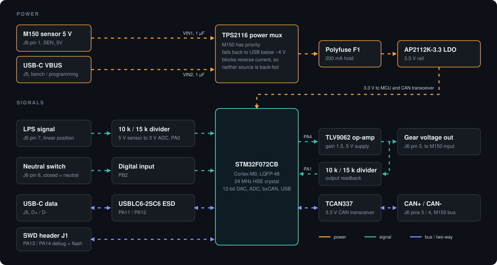

# GearSensor STM32

Gear position sensor board for a MoTeC M150 paddle-shift system: an `STM32F072` reads a linear position sensor and the neutral switch, works out the current gear, and reports it to the ECU as an analog voltage, with a CAN transceiver on the ECU bus and status LEDs on the board. Powered from the M150 sensor 5 V or USB-C, and replaces the Arduino UNO R4 WiFi and shield build described on the [GearSensor project page](https://chithigunatilake.com/GearSensor/).

## Architecture

- **Power** - 5 V in from the M150 sensor supply (`SEN_5V`, J3) or from USB-C VBUS (`J1`). A `TPS2116` power mux (`U2`) gives the car priority and falls back to USB when the car rail drops below about 4 V (set by `R3`/`R4`, 300 k / 100 k). It blocks reverse current, so the ECU supply is never back-fed from a laptop and the laptop is never back-fed from the car. The mux status pin goes to `PA2` (`MUX_STAT`: high = car, low = USB). 1 uF on each mux input, a 300 mA polyfuse (`F1`) on the mux output and an `AP2112K-3.3` LDO (`U1`) after it. There is no reverse-polarity stage because a sensor supply cannot be reversed by the battery.
- **Compute** - `STM32F072CB` (`U6`, LQFP-48) with a 24 MHz `ABM8AIG` crystal on HSE, which CAN needs for accurate bit timing. Ferrite-filtered VDDA (`FB1`, with `C18` 1 uF and `C19` 10 nF after it), NRST and BOOT0 buttons.
- **Position and neutral sensing** - linear position sensor on J3 pin 7, scaled by `R5`/`R6` (10 k / 15 k) so a 5 V sensor swing lands inside the 3.3 V ADC range on `PA0`, with a 100 nF filter (`C20`) at the pin. Neutral switch on J3 pin 6 into `PB2` through `R28` (1 k). An `AQ1005-01ETG` TVS (`D1`, `D2`) on each harness input.
- **Gear output** - the STM32's own 12-bit DAC on `PA4` (output buffer off, so it can reach 0 V) drives a `TLV9062` op-amp (`U4`) at a gain of 1.5 (`R11` 4.99 k / `R12` 10 k) from the 5 V rail, giving the gear-position voltage on J3 pin 3 up to about 4.1 V through two 390 ohm 0603 series resistors (`R29`/`R30`) and a TVS (`D3`). `R10` (1 M) holds the output at 0 V until the firmware enables the DAC. A 10 k / 15 k divider (`R14`/`R15`, filtered by `C21`) reads the output back on `PA1` for closed-loop trim. The unused op-amp channel is tied off as a follower.
- **Status LEDs** - six `XL-2012SURUGC` red/green LEDs: `LED1` to `LED4` show the gear (or a fault) in combination, `LED5` shows MCU status and `LED6` shows the neutral switch. Their anodes share an `LED_5V` rail behind the slide switch `SW3`, which turns every LED off. Each die has its own series resistor (390 ohm red, 680 ohm green) and is sunk by a 5 V-tolerant MCU pin, so no driver is needed.
- **CAN** - `TCAN337` 3.3 V transceiver (`U5`) on `PB9` / `PB8`, with fault on `PB0` and silent mode on `PB1`. CAN+ / CAN- on J3 pins 5 and 4.
- **Debug and USB** - `J1` USB-C with 5.1 k CC pull-downs and a `USBLC6-2SC6` ESD array (`U3`) on D+ / D- into the MCU's native USB (`PA11` / `PA12`). 4-pin SWD header `J2` and a Tag-Connect TC2030 footprint `J4` (pads only, nothing to buy) on the same SWD, reset and 3.3 V nets. Test pads on the rails and every external signal.

The diagram is animated: dashes show the direction of flow, amber for power, teal for signals, blue for buses. If your viewer does not animate SVGs, the arrows still show the same paths.

## Car connector (J3)

Solder-wire pigtails, not a board connector: eight PTH pads in a row along the bottom edge (`gear:SolderWire-0.5sqmm_1x08_P4.2mm_D0.9mm_OD2.1mm_Relief_Anchored`, 1.15 mm holes for 0.5 mm² or smaller wire, 4.2 mm pitch), pin 1 on the right, labelled on both sides.

The pads are built not to tear out:

- **Annular ring:** 3.0 mm pads on 1.15 mm holes (0.93 mm ring), on all four copper layers, so the inner layers also hold the barrel.
- **Anchor vias:** two plated 0.3 mm vias inside each pad, on the side away from the relief hole (opposite the pull), through every layer. They rivet the pad copper to the board, and the GND pin's vias will also tie into the ground planes when they are poured.
- **Strain relief:** a 2.3 mm hole 3.6 mm from each pad towards the board edge, for insulation up to about 2.1 mm. The hole is plated (no net) so the wire bears on a smooth copper barrel instead of cut glass fibre, which chafes insulation under vibration. A silk ring marks each one, and "STRAIN RELIEF HOLES - DO NOT SOLDER" is printed directly under the row on both sides.

Fitting a wire: bring it in from the edge on the underside, up through its relief hole, across the top, and down into its pad, then solder it on the underside. Do not solder the relief hole. A pull on the harness then loads the relief hole, not the solder joint.

- **Vibration:** use abrasion-resistant insulation (ETFE/Tefzel, as most car harnesses do) and stake each wire to the board with RTV or a flexible adhesive at the relief hole and the pad. That stops the wire moving, which is what chafes the insulation and fatigues the wire where the solder stops wicking.
- **Edge web:** the board is 2 mm taller than square (50 x 52 mm) so there is 2.8 mm of FR4 between each relief hole and the bottom edge, which takes the pull. Still clamp the harness at the enclosure gland, so its weight does not hang off the board.

There are no cable-tie slots: the only free board edge beside the pigtail row is taken by the M3 mounting holes and their standoffs, so tie the harness to the enclosure at the cable gland instead.

| Pin | Net | Function |
|---|---|---|
| 1 | `SEN_5V` | M150 sensor 5 V in |
| 2 | `GND` | Ground |
| 3 | `GEAR_OUT` | Gear voltage out to the ECU |
| 4 | `CAN-` | CAN low |
| 5 | `CAN+` | CAN high |
| 6 | `NEUT_SW` | Neutral switch |
| 7 | `SPS` | Linear position sensor signal |
| 8 | - | Not connected |

## Status LEDs

Six red/green LEDs along the top edge, labelled on the silkscreen. Left to right: `NEUT` (`LED6`), `STAT` (`LED5`), `MODE` (`LED4`), then the code LEDs `4`, `2` and `1` (`LED3`, `LED2`, `LED1`). The three code LEDs read as a binary number. The same legend is on the back silkscreen. `SW3` (`LED ON/OFF`) turns every LED off in hardware.

| What you see | Meaning |
|---|---|
| `4 2 1` green, `MODE` green | Gear 1 to 6 in binary (1 = 001, 6 = 110). `111` is neutral. |
| `4 2 1` green, `MODE` amber | Shifting: the new gear, waiting for the actuator to return |
| `4 2 1` red, `MODE` red blinking 2 Hz | Unknown gear, reason code 1 to 3. Gear output 0 V. |
| `4 2 1` red, `MODE` red solid | Fault, reason code 4 to 7. Gear output 0 V. |
| `STAT` blinking 1 Hz | Firmware running: green on car power, amber on USB power, red while a fault is active. A steady or dark `STAT` means the main loop has stopped. |
| `NEUT` green | Neutral switch closed |
| `NEUT` red | Gear count and neutral switch disagree (reason 2) |

Reason codes: 1 not known at start-up, 2 position sensor count and neutral switch disagree, 3 neutral switch opened with no shift, 4 position sensor out of range, 5 position sensor did not return to rest, 6 gear output readback mismatch, 7 VDDA implausible. See the [firmware plan](docs/firmware-plan.md) for the state machine.

## From the Arduino version

- Same job, same sensors, same ECU interface. The shift logic, trust model and FMEA are documented on the [project page](https://chithigunatilake.com/GearSensor/).
- One board replaces the Arduino UNO R4 WiFi and shield.
- The gear-voltage output is read back through an ADC pin again, which version 2 of the Arduino build dropped.
- Status LEDs replace the LED matrix. This board has no WiFi or Bluetooth, so the phone display does not carry over. USB-C and the SWD header are the way in for programming and debug.
- The firmware is in Rust ([`firmware/`](firmware)), written to the [firmware plan](docs/firmware-plan.md). It builds and its logic is unit tested on the PC, but it has not run on a board yet.

## Status

Work in progress. The 50 x 52 mm PCB is placed but not yet routed. The firmware builds and its logic tests pass on the PC; it has not been flashed to a board. Not run on a car.

## Repo contents

- [KiCad project](gearPosSens.kicad_pro)
- [Schematic](gearPosSens.kicad_sch)
- [PCB layout](gearPosSens.kicad_pcb)
- [Power and gear-output design notes](power-mux-notes.md)
- [Firmware](firmware) (Rust, Embassy)
- [Firmware plan](docs/firmware-plan.md) and its [architecture diagram](docs/firmware-architecture.svg)
- [Symbols, footprints and 3D models](library)
